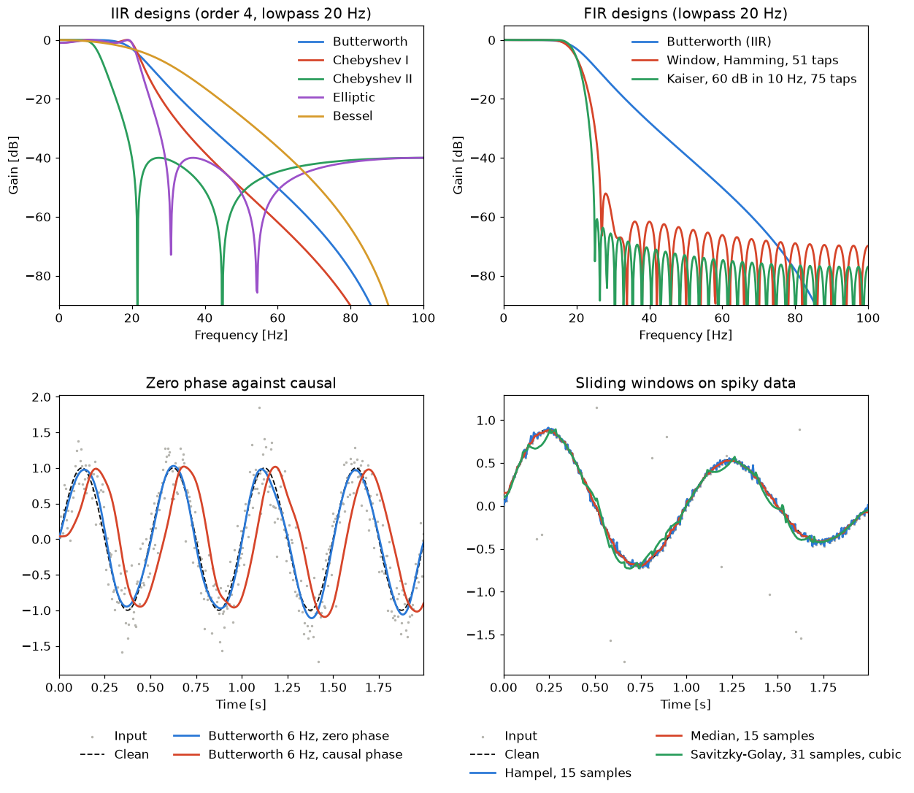

# SignalFilter

## Overview

SignalFilter (`signal_filter`) is a typed Python package for filtering sampled signals before analysis. Every filter is an immutable object with one `apply` method that takes samples along the first axis, with any number of channels after it, and returns a float64 array of the same shape.

| Category | Filters | Use for |
| -------- | ------- | ------- |
| [IIR](src/signal_filter/frequency_selective_filters/iir_filters/README.md) | `ButterworthFilter`, `ChebyshevType1Filter`, `ChebyshevType2Filter`, `EllipticFilter`, `BesselFilter`, `NotchFilter` | Lowpass, highpass, bandpass, and bandstop with few coefficients; removing one frequency such as power-line hum |
| [FIR](src/signal_filter/frequency_selective_filters/fir_filters/README.md) | `WindowFIRFilter`, `KaiserFIRFilter` | Linear-phase band filters, also designed from a transition width and an attenuation |
| [Sliding window](src/signal_filter/sliding_window_filters/README.md) | `MovingAverageFilter`, `MedianFilter`, `SavitzkyGolayFilter`, `HampelFilter` | Smoothing, smoothed derivatives, and removing impulses and outliers |

IIR and FIR filters run with `Phase.ZERO` (forward and backward: no delay, squared magnitude) or `Phase.CAUSAL` (forward only, as in real time), and report their `frequency_response`. Sliding window filters center their window on each sample and fill it beyond the ends as `Boundary` says.



## Installation

```bash
uv add git+https://github.com/ry-yoshida-dev/SignalFilter
```

or, from a clone, `uv sync`.

## Usage

Keep the band from 0.5 to 40 Hz of a three-channel recording sampled at 250 Hz, after removing its outliers:

```python
import numpy as np

from signal_filter import Band, ButterworthFilter, HampelFilter

recording = np.random.default_rng(0).standard_normal((5000, 3))  # (samples, channels)

outliers = HampelFilter(window_length=11)
bandpass = ButterworthFilter(band=Band.bandpass(0.5, 40.0), sampling_rate=250.0, order=4)

outliers.detect(recording)  # True at each outlier
cleaned = bandpass.apply(outliers.apply(recording))  # shape (5000, 3)
```

Check a design before using it:

```python
from signal_filter import KaiserFIRFilter, NotchFilter, Phase

notch = NotchFilter(frequency=50.0, quality_factor=30.0, sampling_rate=250.0)
notch.frequency_response([49.0, 50.0, 51.0]).gain_db  # zero-phase gain in dB

lowpass = KaiserFIRFilter(
    band=Band.lowpass(30.0),
    transition_width=5.0,
    attenuation=60.0,
    sampling_rate=250.0,
    phase=Phase.CAUSAL,
)
lowpass.taps, lowpass.group_delay  # length the specification needs, and its delay in seconds
lowpass.coefficients  # impulse response
```

Smooth, or differentiate, with a Savitzky-Golay filter:

```python
from signal_filter import SavitzkyGolayFilter

smoothed = SavitzkyGolayFilter(window_length=21, polynomial_order=3).apply(recording)
velocity = SavitzkyGolayFilter(
    window_length=21, polynomial_order=3, derivative=1, sample_spacing=1 / 250.0
).apply(recording)  # per second
```

## Development

[docs/draw_filters_figure.py](docs/draw_filters_figure.py) redraws the figure above. It declares its own dependencies, including [MatplotlibUtilities](https://github.com/ry-yoshida-dev/MatplotlibUtilities), so the package does not depend on them:

```bash
uv run docs/draw_filters_figure.py
```
